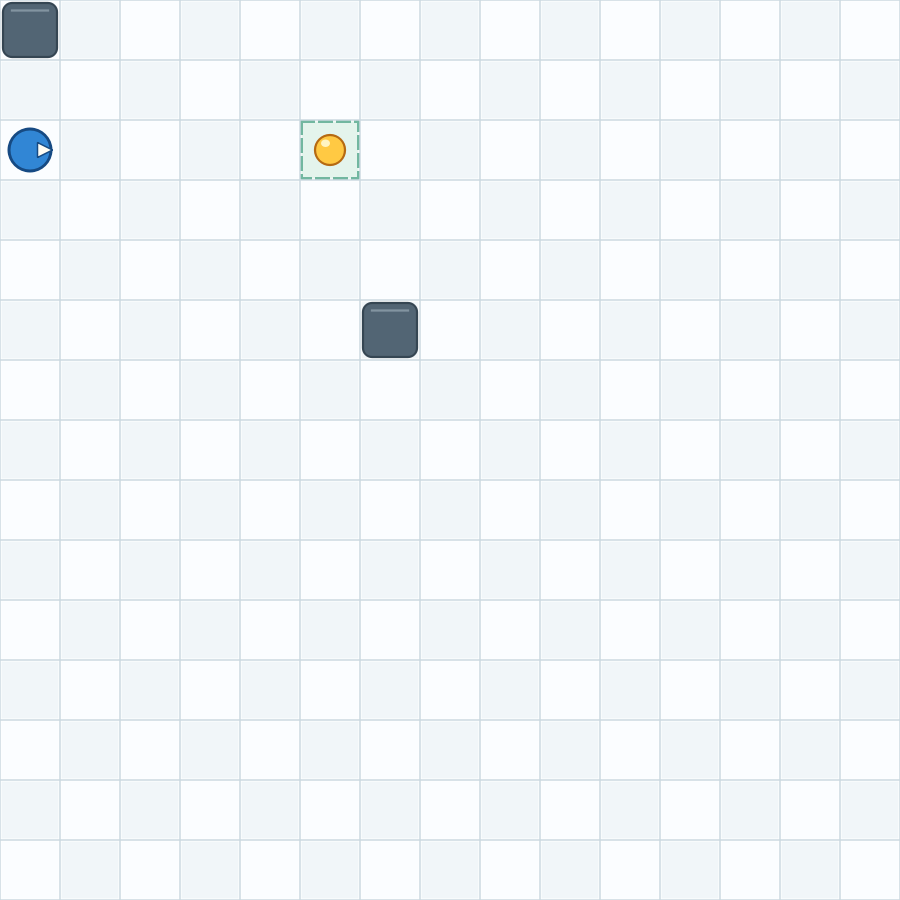

# Pyti Lernumgebung

Aktuelle Version: **1.4.0**

Eine lokale Lernumgebung für Python und algorithmisches Denken. In einer grafischen PySide6-Anwendung programmiert man den Roboter Pyti, navigiert durch ein 15x15-Spielfeld und löst Level mit Wänden und Beepern.

Das ausführliche Handbuch für Lernende und Administratoren gibt es als
[druckfertige PDF mit 100 Level-Arbeitsblättern](BENUTZERHANDBUCH_Pyti.pdf),
[Markdown-Handbuch](BENUTZERHANDBUCH.md) und
[Levelatlas-Quelldatei](BENUTZERHANDBUCH_LEVELATLAS.md).

## Funktionen

- Interaktives 15x15-Spielfeld
- 100 vorgefertigte Level von `0.0.1` bis `1.0.0` mit Missionszielen
- Ansteigender Schwierigkeitsgrad von ersten Bewegungen bis zu komplexen
  Sprung- und Meisterlabyrinthen
- Automatische Prüfung, ob der Ziel-Beeper aufgenommen wurde
- Editor mit Zeilennummern, Python-Syntax-Highlighting und Tab-Unterstuetzung
- Optionales Beispiele-Fenster mit Inhalten aus `EXAMPLES.md`
- Roboterbewegung mit sichtbarer Richtungsanzeige
- Wände, Randkollisionen und Beeper
- Beeper aufnehmen und ablegen
- `jump()` springt zwei Rasterfelder weit und nur über eine Wand; das
  Landefeld muss frei und innerhalb des Spielfelds liegen
- Sensorfunktionen fuer Bedingungen und Schleifen
- Beeper koennen per Mausklick auf dem Spielfeld platziert oder entfernt werden
- Waende per Rechtsklick setzen oder entfernen; den Level per Knopfdruck neu starten
- Abwechselnd helle Felder, dezente Zielfeldmarkierung und besser erkennbare Spielobjekte
- Responsive Oberflaeche mit grossem Editorbereich
- Lokales Admin-Panel für Statusprüfungen, Einstellungen, Level und Beispielskripte
- Grafischer Level-Creator mit lokal gespeicherten Entwürfen und automatischer
  Übernahme in die Levelauswahl; Python-Quelltextexport zusätzlich verfügbar

Die aktuelle [Logik- und Plausibilitätsprüfung](docs/LOGIKPRUEFUNG.md) fasst
die Testergebnisse, bestätigten Befunde und priorisierten nächsten Schritte
zusammen. Die offene Planung steht in [ROADMAP.md](ROADMAP.md).

## Voraussetzungen

- Python 3.10 oder neuer
- PySide6
- Ein Desktop-System mit Qt-Unterstützung

## Installation

```bash
git clone <REPOSITORY-URL>
cd pyti_lernprogramm
python -m venv .venv
```

Linux/macOS:

```bash
source .venv/bin/activate
```

Windows PowerShell:

```powershell
.venv\Scripts\Activate.ps1
```

Abhängigkeiten installieren:

```bash
python -m pip install --upgrade pip
python -m pip install -r requirements.txt
```

## Start

```bash
python main.py
```

Das Programm lädt die UI-Datei relativ zu `main.py`. Es kann daher auch aus einem anderen Arbeitsverzeichnis gestartet werden.

## Erste Schritte

1. Wähle rechts ein Level aus.
2. Schreibe ein Python-Skript in den Editor.
3. Klicke auf `Start`.
4. Beobachte Pyti auf dem Spielfeld.
5. Platziere zusaetzliche Beeper per Linksklick oder Waende per Rechtsklick.
6. Mit `Level neu starten` setzt du Pyti und das Spielfeld auf den Anfang
   des ausgewaehlten Levels zurueck.

Beispiel:

```python
while not onBeeper():
    moveForward()

pickBeeper()
```

Im ersten Level laeuft Pyti damit bis zum markierten Zielfeld und sammelt den
Beeper ein. Eine Vorschau des gestalteten Spielfelds ist hier zu sehen:



## Verfuegbare Befehle

### Aktionen

| Befehl | Beschreibung |
| --- | --- |
| `moveForward()` | Einen Schritt in Blickrichtung gehen |
| `turnLeft()` | 90 Grad nach links drehen |
| `turnRight()` | 90 Grad nach rechts drehen |
| `turnAround()` | 180 Grad drehen |
| `pickBeeper()` | Beeper vom aktuellen Feld aufnehmen |
| `dropBeeper()` | Einen Beeper aus dem Inventar ablegen |
| `jump()` | Genau eine Wand überspringen und zwei Rasterfelder weiter auf einem freien Feld landen |

### Sensoren

| Sensor | Rückgabe |
| --- | --- |
| `onBeeper()` | `True`, wenn auf dem aktuellen Feld ein Beeper liegt |
| `beeperAhead()` | `True`, wenn direkt vor Pyti ein Beeper liegt |
| `frontClear()` | `True`, wenn das Feld vor Pyti frei ist |
| `leftClear()` | `True`, wenn das Feld links frei ist |
| `rightClear()` | `True`, wenn das Feld rechts frei ist |
| `anyBeeperInBag()` | `True`, wenn Pyti mindestens einen Beeper traegt |

Da der Editor Python-Code ausführt, können auch `if`, `while`, Variablen und Funktionen verwendet werden.

## Projektstruktur

```text
.
├── main.py                  # Kompatibler Anwendungseinstieg
├── pyti_app/                # Anwendungsmodule (je Datei max. 150 Zeilen)
│   ├── __main__.py          # Paketstart mit python -m pyti_app
│   ├── application.py       # Qt-Start und Objektverdrahtung
│   ├── app_controller.py    # Levelauswahl und Ausführungssteuerung
│   ├── ui_builder.py        # Aufbau der Fenster-Widgets
│   ├── robot.py             # Roboterbewegung und Inventar
│   ├── field_manager.py     # Spielfeldzustand und Sensorlogik
│   ├── field_rendering.py   # Zeichnen von Raster und Spielfiguren
│   ├── field_view.py        # Mausklicks und Qt-Spielfeldansicht
│   ├── script_runtime.py    # Pyti-Befehle und Skriptausführung
│   ├── script_worker.py     # Worker-Thread und Qt-Signalbrücke
│   ├── admin_panel.py       # Lokales Verwaltungsfenster
│   ├── admin_checks.py     # Funktions- und Levelprüfungen
│   ├── admin_store.py      # Lokale Konfiguration und Levelvalidierung
│   ├── level_specs.py       # Quelldaten der Missionen
│   ├── level_generator.py   # Level- und Wandgenerator
│   ├── levels.py            # Erzeugte Levelsammlung
│   ├── editor.py            # Code-Editor mit Zeilennummern
│   └── highlighter.py       # Python-Syntax-Highlighting
├── tests/                   # Verhaltenstests
├── commands.py, pyti.py,    # Kompatible Importe für bisherige Einstiegspunkte
│   playing_field.py, ...
├── game_window.ui           # Qt-Grundfenster
├── EXAMPLES.md              # Beispielprogramme und Programmiermuster
├── requirements.txt         # Python-Abhaengigkeiten
├── VERSION                  # Aktuelle Version
├── CHANGELOG.md             # Versionshistorie
├── ROADMAP.md               # Geplante Erweiterungen
├── LICENSE                  # MIT-Lizenz
└── docs/
    └── ARCHITECTURE.md      # Technische Architektur
```

## Tests und lokale Pruefung

Automatisierte Verhaltenstests pruefen Bewegung, Drehungen, Kollisionen,
Sensoren, Beeper-Inventar, Zielprüfung und die Erreichbarkeit aller Level.
Ein zusätzlicher Test stellt sicher, dass keine Python-Datei die Grenze von
150 Zeilen überschreitet. Fuehre sie aus dem Projektverzeichnis aus:

```bash
python -m unittest discover -s tests -v
```

Die folgenden Befehle pruefen zusaetzlich die Python-Syntax und den Start der
Anwendung.

Syntaxpruefung:

```bash
python -m compileall -q pyti_app tests *.py
```

Headless-Start unter Linux:

```bash
QT_QPA_PLATFORM=offscreen python main.py
```

## Administration

Über `Administration` öffnet sich ein lokales Verwaltungsfenster. Es zeigt
Prüfungen für die Spiellogik, Importe, die Erreichbarkeit aller Level, die
Oberfläche, die gespeicherte Konfiguration und den letzten Skriptfehler.
Außerdem lassen sich Zeitlimit und Aktionsgeschwindigkeit ändern, Level
visuell bearbeiten sowie Beispielskripte speichern und in den Editor laden.
Ungültige Leveländerungen, etwa ein unerreichbares Ziel, werden beim Speichern
abgewiesen.

Die Einstellungen werden im Benutzer-Konfigurationsordner der Plattform
gespeichert und beim nächsten Start wieder geladen. Der Admin-Knopf hat
absichtlich kein Passwort: Er ist für die Verwaltung der lokalen Installation
gedacht und stellt keine Zugriffssicherung gegen andere Benutzer des Geräts
dar. Skriptvorlagen können beliebigen Python-Code enthalten; auch sie sind
nicht sandboxed.

Fuer einen kurzen Smoke-Test kann der Prozess mit `timeout` beendet werden:

```bash
timeout 2s env QT_QPA_PLATFORM=offscreen python main.py
```

## Sicherheitswarnung

Die Anwendung verwendet in `pyti_app/script_runtime.py` `exec()`, damit
Lernende normalen Python-Code mit den bereitgestellten Pyti-Befehlen schreiben
koennen. Die Ausfuehrung erfolgt im Prozess der Anwendung und hat Zugriff auf
die verfuegbaren Python-Builtins. Dadurch kann ein Skript grundsaetzlich auch
Dateien lesen oder veraendern und Prozesse starten. Fuehre deshalb nur
vollstaendig vertrauenswuerdige Skripte aus. Die Anwendung ist keine Sandbox
fuer fremden oder nicht vertrauenswuerdigen Code.

Skripte werden standardmäßig nach 30 Sekunden Python-Ausführungszeit
abgebrochen. Das Zeitlimit lässt sich im Admin-Panel zwischen 1 und 300
Sekunden einstellen. Es kann lang laufende Skripte beenden, unterbricht aber
keine einzelne blockierende Operation innerhalb einer Python-Erweiterung.

Die Skriptausfuehrung laeuft in einem Hintergrundthread. Pyti-Befehle werden
ueber Qt-Signale im GUI-Thread ausgefuehrt; waehrenddessen kann die Anwendung
weiter bedient werden. Mit `Stopp` lassen sich laufende Python-Schleifen
abbrechen. Eine einzelne blockierende Operation innerhalb einer Python-
Erweiterung kann auch dadurch nicht unterbrochen werden.

## Versionierung

Die aktuelle Version steht in [VERSION](VERSION). Änderungen werden in [CHANGELOG.md](CHANGELOG.md) dokumentiert. Das Projekt verwendet Semantic Versioning:

- `MAJOR`: inkompatible Aenderungen
- `MINOR`: neue abwaertskompatible Funktionen
- `PATCH`: Fehlerkorrekturen

## Lizenz

Das Projekt steht unter der MIT-Lizenz. Die vollstaendige Lizenz steht in
[LICENSE](LICENSE).

## GitHub-Check

Vor dem ersten Push sollten diese lokalen Pruefungen erfolgreich sein:

```bash
python -m compileall -q pyti_app tests *.py
QT_QPA_PLATFORM=offscreen timeout 2s python main.py
```

Das Projekt benötigt keine Datenbank und keinen Build-Schritt. Die MIT-Lizenz
ist bereits als `LICENSE`-Datei enthalten.
