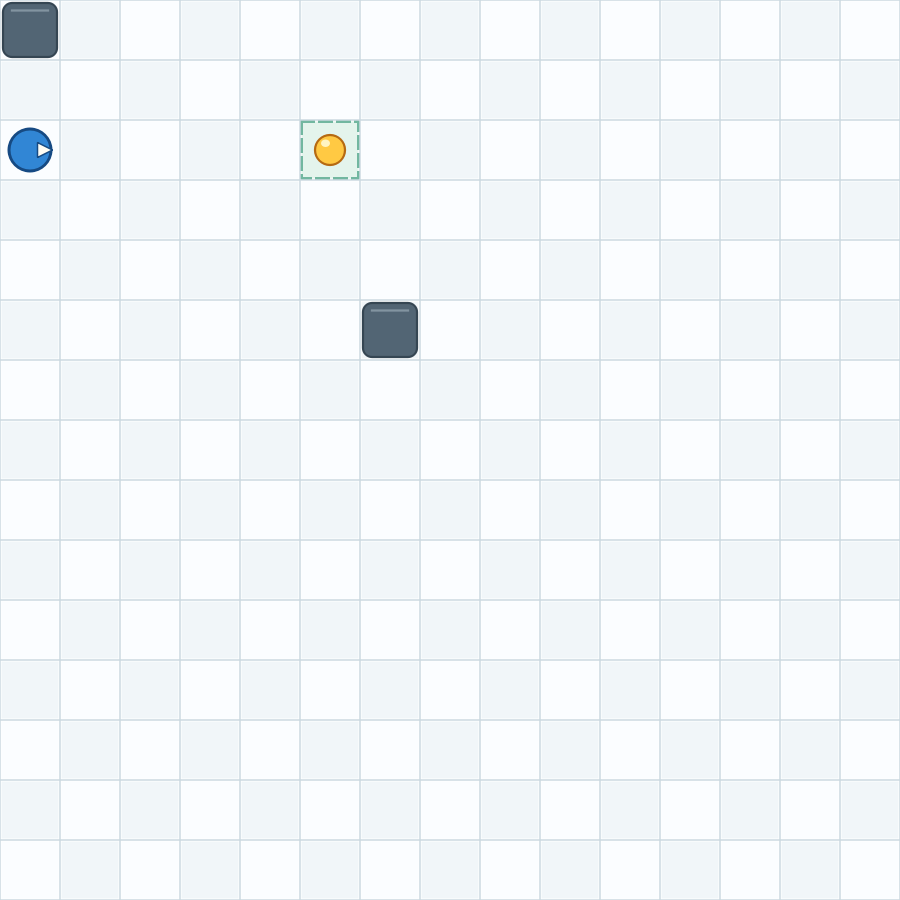

# Pyti Lernumgebung

Aktuelle Version: **1.6.0**

Eine lokale Lernumgebung für Python und algorithmisches Denken. In einer grafischen PySide6-Anwendung programmiert man den Roboter Pyti, navigiert durch ein 15x15-Spielfeld und löst Level mit Wänden und Beepern.

Das ausführliche Handbuch für Lernende und Administratoren gibt es als
[druckfertige PDF mit 100 Level-Arbeitsblättern](BENUTZERHANDBUCH_Pyti.pdf),
[Markdown-Handbuch](BENUTZERHANDBUCH.md) und
[Levelatlas-Quelldatei](BENUTZERHANDBUCH_LEVELATLAS.md).

## Projektinfo

| | |
|---|---|
| **Idee** | Python und algorithmisches Denken durch sichtbare Aufgaben mit dem Roboter Pyti vermitteln. |
| **Initiator und Hauptentwickler** | Thomas Heddes · [@heddes-python-dev](https://github.com/heddes-python-dev) |
| **Öffentlicher Projektstart** | 19. September 2026; an diesem Tag wurde der erste Commit im öffentlichen Repository veröffentlicht. |
| **Aktueller Stand** | Version 1.6.0 mit lokalem Lernfortschritt, Lernpfad-Hilfen, einstellbarer Ausführungsgeschwindigkeit und Linux-Skriptsandbox |
| **Lizenz** | [MIT-Lizenz](LICENSE) |
| **Quellcode und Mitarbeit** | [GitHub-Projekt](https://github.com/heddes-python-dev/pyti_lernumgebung) |

### Mitwirkende

Pyti wird offen weiterentwickelt. Zu den bisherigen Mitwirkenden auf GitHub
gehören [@heddes-python-dev](https://github.com/heddes-python-dev) für die
Projektentwicklung, [@iLollek](https://github.com/iLollek) für eine Korrektur
von Rechtschreibung und Grammatik in der README und
[@SansikaDev](https://github.com/SansikaDev) für einen Regressionstest, der
Menüaktionen während der Skriptausführung prüft. Beiträge zu Code,
Dokumentation, Übersetzungen und Unterrichtserprobung sind willkommen.

### Status für Schulen

Pyti ist ein wachsendes Open-Source-Lernprojekt, aber keine zertifizierte
Schulsoftware. Auf Linux führt die App Lernskripte in einem separaten
bubblewrap-Prozess mit eingeschränkten Dateisystem-, Netzwerk- und
Ressourcenrechten aus. Diese Isolation ist noch nicht unabhängig
sicherheitsgeprüft; unbeaufsichtigte Nutzung und Kindertests auf normalen
Rechnern sind deshalb nicht freigegeben. Auf macOS und Windows wird die
Skriptausführung derzeit verweigert. Schul-Pilotierung, Barrierefreiheit,
Installationsprüfung und unabhängige Sicherheitsprüfung bleiben offen;
siehe [Roadmap](ROADMAP.md).

Die geführte erste Mission und ihre Vorlagen sind implementiert und
automatisiert geprüft. Eine pädagogische Erprobung mit Lernenden hat noch
nicht stattgefunden.
Der Lernweg-Status und die offenen Schritte stehen in der
[pädagogischen Roadmap](docs/LERNWEG_ROADMAP.md).

## Funktionen

- Interaktives 15x15-Spielfeld
- 100 vorgefertigte Level von `0.0.1` bis `1.0.0` mit Missionszielen
- Ansteigender Schwierigkeitsgrad von ersten Bewegungen bis zu komplexen
  Sprung- und Meisterlabyrinthen
- Automatische Prüfung, ob der Ziel-Beeper aufgenommen wurde
- Lernfortschritt lokal speichern und beim Neustart wiederherstellen;
  abgeschlossene Level schalten den Weg zum nächsten Level frei
- Pro Level ein Lernziel, ein aufrufbarer Tipp und eine Reflexionsfrage
- Animationsgeschwindigkeit während der Laufzeit zwischen schnell und
  langsam einstellen
- Editor mit Zeilennummern, Python-Syntax-Highlighting und Tab-Unterstuetzung
- Optionales Beispiele-Fenster mit Inhalten aus `EXAMPLES.md`
- Geführte erste Mission unter **Hilfe → Erste Mission** für ausgewählte
  Level von `0.0.1` bis `0.1.0`, mit vollständigem Beispiel,
  Ein-Aktions-Lückenvorlage, gestuften Tipps und freischaltbarer Lösung
- Roboterbewegung mit sichtbarer Richtungsanzeige
- Wände, Randkollisionen und Beeper
- Beeper aufnehmen und ablegen
- `jump()` springt zwei Rasterfelder weit und nur über eine Wand; das
  Landefeld muss frei und innerhalb des Spielfelds liegen
- Sensorfunktionen fuer Bedingungen und Schleifen
- Beeper koennen per Mausklick auf dem Spielfeld platziert oder entfernt werden
- Waende per Rechtsklick setzen oder entfernen; den Level per Knopfdruck neu starten
- Abwechselnd helle Felder, dezente Zielfeldmarkierung und besser erkennbare Spielobjekte
- Responsive Oberflaeche mit grossem Editorbereich
- Zentraler lokaler Admin-Bereich für Status, Einstellungen, Level,
  Beispielskripte, Level-Creator und Datensicherungen
- Grafischer Level-Creator mit lokal gespeicherten Entwürfen und automatischer
  Übernahme in die Levelauswahl; eigene gespeicherte Level können im Creator
  oder Admin-Panel gelöscht werden; Python-Quelltextexport zusätzlich verfügbar
- Allgemeine Aktionen wie Beispiele, Administration und Projektinfo in der Menüleiste

Die aktuelle [Logik- und Plausibilitätsprüfung](docs/LOGIKPRUEFUNG.md) fasst
die Testergebnisse, bestätigten Befunde und priorisierten nächsten Schritte
zusammen. Die technische Projektplanung steht in [ROADMAP.md](ROADMAP.md);
die separate pädagogische [Lernweg-Roadmap](docs/LERNWEG_ROADMAP.md)
beschreibt die geplante Lernprogression.

## Optionaler Pyti Inspector

Der [Pyti Inspector](docs/INSPECTOR.md) ist ein eigenständiges externes
Entwicklungswerkzeug für Live-Telemetrie. Er ist nicht Teil dieses
Repositories oder der Pyti-Installation. Sein Launcher kann Pyti zur Laufzeit
anbinden, ohne Pyti-Dateien zu verändern. Dazu müssen beide Programme separat
vorliegen und mit demselben Python-Interpreter gestartet werden. Ohne den
externen Launcher sendet Pyti keine Telemetrie.

## Mitmachen

Pyti ist Open Source unter der [MIT-Lizenz](LICENSE). Fehlerberichte,
Verbesserungsideen, Übersetzungen, Unterrichtserfahrungen und Codebeiträge
sind willkommen. Nutze die Issues und Pull Requests des
[GitHub-Projekts](https://github.com/heddes-python-dev/pyti_lernumgebung);
beschreibe bei Fehlern möglichst die Schritte zur Reproduktion, dein
Betriebssystem und deine Python-Version.

### Good First Issues

Du möchtest mithelfen? Diese kleinen, klar abgegrenzten Aufgaben sind ein
guter Einstieg. Auf GitHub findest du weitere Tickets mit dem Label
[good first issue](https://github.com/heddes-python-dev/pyti_lernumgebung/issues?q=is%3Aissue+is%3Aopen+label%3A%22good+first+issue%22).

- [Einsteigerübung zu Schleifen ergänzen](https://github.com/heddes-python-dev/pyti_lernumgebung/issues/2)
- [Tastenkürzel zum Neustart des aktuellen Levels](https://github.com/heddes-python-dev/pyti_lernumgebung/issues/3)
- [Fehlerdetails in die Zwischenablage kopieren](https://github.com/heddes-python-dev/pyti_lernumgebung/issues/4)

Lies vor deinem Beitrag den [Leitfaden zum Mitwirken](CONTRIBUTING.md) und
kommentiere das gewünschte Issue vor Beginn, damit andere sehen, dass du
daran arbeitest.

Die Schritte zum Forken, Einrichten, Erstellen eines Feature-Branches und
Ausführen der Prüfungen stehen im [Leitfaden zum Mitwirken](CONTRIBUTING.md);
Review- und Release-Zuständigkeiten beschreibt die
[Projektverantwortung](GOVERNANCE.md).

Für lokale Entwicklung installierst du die Abhängigkeit wie oben beschrieben
und führst die Tests aus:

```bash
python -m unittest discover -s tests -v
python -m compileall -q pyti_app tests docs *.py
git diff --check
```

Lernskripte werden auf Linux in einem eingeschränkten bubblewrap-Prozess
ausgeführt. Die Isolation ist eine zusätzliche Schutzschicht, keine
Sicherheitszertifizierung: Bis zur unabhängigen Prüfung nur vertrauenswürdige
Skripte ausführen. Für die Skriptausführung werden Linux, bubblewrap und
aktivierte User Namespaces benötigt. Auf anderen Betriebssystemen bleibt die
Skriptausführung deaktiviert.

## Voraussetzungen

- Python 3.10 oder neuer
- PySide6
- Linux-Desktop mit Qt-Unterstützung für die Skriptausführung
- bubblewrap (`bwrap`) und aktivierte User Namespaces

Auf Debian/Ubuntu wird bubblewrap beispielsweise mit
`sudo apt install bubblewrap` installiert. Andere Distributionen stellen es
über ihren jeweiligen Paketmanager bereit. Auf macOS/Windows kann die
Oberfläche gegebenenfalls starten, Skripte werden dort aber nicht ausgeführt.

## Installation

```bash
git clone <REPOSITORY-URL>
cd pyti_lernprogramm
python -m venv .venv
```

Linux/macOS:

```bash
source .venv/bin/activate
```

Windows PowerShell:

```powershell
.venv\Scripts\Activate.ps1
```

Abhängigkeiten installieren:

```bash
python -m pip install --upgrade pip
python -m pip install -r requirements.txt
```

## Start

```bash
python main.py
```

Das Programm lädt die UI-Datei relativ zu `main.py`. Es kann daher auch aus einem anderen Arbeitsverzeichnis gestartet werden.

## Erste Schritte

1. Wähle rechts ein Level aus.
2. Schreibe ein Python-Skript in den Editor.
3. Klicke auf `Start`.
4. Beobachte Pyti auf dem Spielfeld.
5. Platziere zusaetzliche Beeper per Linksklick oder Waende per Rechtsklick.
6. Mit `Level neu starten` setzt du Pyti und das Spielfeld auf den Anfang
   des ausgewaehlten Levels zurueck.

Beispiel:

```python
while not onBeeper():
    moveForward()

pickBeeper()
```

Im ersten Level laeuft Pyti damit bis zum markierten Zielfeld und sammelt den
Beeper ein. Eine Vorschau des gestalteten Spielfelds ist hier zu sehen:



## Verfuegbare Befehle

### Aktionen

| Befehl | Beschreibung |
| --- | --- |
| `moveForward()` | Einen Schritt in Blickrichtung gehen |
| `turnLeft()` | 90 Grad nach links drehen |
| `turnRight()` | 90 Grad nach rechts drehen |
| `turnAround()` | 180 Grad drehen |
| `pickBeeper()` | Beeper vom aktuellen Feld aufnehmen |
| `dropBeeper()` | Einen Beeper aus dem Inventar ablegen |
| `jump()` | Genau eine Wand überspringen und zwei Rasterfelder weiter auf einem freien Feld landen |

### Sensoren

| Sensor | Rückgabe |
| --- | --- |
| `onBeeper()` | `True`, wenn auf dem aktuellen Feld ein Beeper liegt |
| `beeperAhead()` | `True`, wenn direkt vor Pyti ein Beeper liegt |
| `frontClear()` | `True`, wenn das Feld vor Pyti frei ist |
| `leftClear()` | `True`, wenn das Feld links frei ist |
| `rightClear()` | `True`, wenn das Feld rechts frei ist |
| `anyBeeperInBag()` | `True`, wenn Pyti mindestens einen Beeper traegt |

Da der Editor Python-Code ausführt, können auch `if`, `while`, Variablen und Funktionen verwendet werden.

## Projektstruktur

```text
.
├── main.py                  # Kompatibler Anwendungseinstieg
├── pyti_app/                # Anwendungsmodule (je Datei max. 150 Zeilen)
│   ├── __main__.py          # Paketstart mit python -m pyti_app
│   ├── application.py       # Qt-Start und Objektverdrahtung
│   ├── app_controller.py    # Levelauswahl und Ausführungssteuerung
│   ├── ui_builder.py        # Aufbau der Fenster-Widgets
│   ├── robot.py             # Roboterbewegung und Inventar
│   ├── field_manager.py     # Spielfeldzustand und Sensorlogik
│   ├── field_rendering.py   # Zeichnen von Raster und Spielfiguren
│   ├── field_view.py        # Mausklicks und Qt-Spielfeldansicht
│   ├── script_runtime.py    # Pyti-Befehle und Skriptausführung
│   ├── script_worker.py     # Worker-Thread und Qt-Signalbrücke
│   ├── admin_panel.py       # Lokales Verwaltungsfenster
│   ├── admin_checks.py     # Funktions- und Levelprüfungen
│   ├── admin_store.py      # Lokale Konfiguration und Levelvalidierung
│   ├── level_specs.py       # Quelldaten der Missionen
│   ├── level_generator.py   # Level- und Wandgenerator
│   ├── levels.py            # Erzeugte Levelsammlung
│   ├── editor.py            # Code-Editor mit Zeilennummern
│   └── highlighter.py       # Python-Syntax-Highlighting
├── tests/                   # Verhaltenstests
├── commands.py, pyti.py,    # Kompatible Importe für bisherige Einstiegspunkte
│   playing_field.py, ...
├── game_window.ui           # Qt-Grundfenster
├── EXAMPLES.md              # Beispielprogramme und Programmiermuster
├── requirements.txt         # Python-Abhaengigkeiten
├── VERSION                  # Aktuelle Version
├── CHANGELOG.md             # Versionshistorie
├── ROADMAP.md               # Geplante Erweiterungen
├── LICENSE                  # MIT-Lizenz
└── docs/
    └── ARCHITECTURE.md      # Technische Architektur
```

## Tests und lokale Pruefung

Automatisierte Verhaltenstests pruefen Bewegung, Drehungen, Kollisionen,
Sensoren, Beeper-Inventar, Zielprüfung und die Erreichbarkeit aller Level.
Ein zusätzlicher Test stellt sicher, dass keine Python-Datei die Grenze von
150 Zeilen überschreitet. Fuehre sie aus dem Projektverzeichnis aus:

```bash
python -m unittest discover -s tests -v
```

Die folgenden Befehle pruefen zusaetzlich die Python-Syntax und den Start der
Anwendung.

Syntaxpruefung:

```bash
python -m compileall -q pyti_app tests *.py
```

Headless-Start unter Linux:

```bash
QT_QPA_PLATFORM=offscreen python main.py
```

## Admin-Bereich

Über **Werkzeuge → Admin-Bereich** öffnet sich die zentrale lokale Verwaltung.
Sie bündelt
Prüfungen für die Spiellogik, Importe, die Erreichbarkeit aller Level, die
Oberfläche, die gespeicherte Konfiguration und den letzten Skriptfehler.
Der Tab **Entwicklertests** listet die Testfälle aus `tests/` einzeln und kann
die vollständige Suite im Hintergrund starten; Testergebnisse und Laufprotokoll
werden im Admin-Bereich angezeigt.
Außerdem lassen sich Zeitlimit und Aktionsgeschwindigkeit ändern, Level
visuell bearbeiten, eigene Level erstellen, Beispielskripte verwalten und
Sicherungen exportieren oder wiederherstellen. Ungültige Leveländerungen,
etwa ein unerreichbares Ziel, werden beim Speichern abgewiesen.

Die Einstellungen werden im Benutzer-Konfigurationsordner der Plattform
gespeichert und beim nächsten Start wieder geladen. Der Menüpunkt
**Werkzeuge → Admin-Bereich** hat absichtlich kein Passwort: Er ist für die
Verwaltung der lokalen Installation gedacht und stellt keine
Zugriffssicherung gegen andere Benutzer des Geräts dar. Skriptvorlagen können
beliebigen Python-Code enthalten; auch sie sind nicht sandboxed.

Fuer einen kurzen Smoke-Test kann der Prozess mit `timeout` beendet werden:

```bash
timeout 2s env QT_QPA_PLATFORM=offscreen python main.py
```

## Sicherheitswarnung

Auf Linux laeuft jedes Lernskript in einem separaten bubblewrap-Kindprozess.
Die Isolation beschraenkt Netzwerk und Dateisystem und setzt
Ressourcenlimits. Sie wurde noch nicht unabhaengig sicherheitsgeprueft und
ist keine Sicherheitszertifizierung. Fuehre bis zu einer solchen Pruefung
nur vertrauenswuerdige Skripte aus. macOS und Windows werden fuer die
Skriptausfuehrung fail-closed abgewiesen.

Die Standardlaufzeit betraegt 30 Sekunden und kann im Admin-Panel zwischen
1 und 300 Sekunden eingestellt werden. Der separate Kindprozess wird bei
Zeitablauf oder Stopp beendet.

Die Skriptausfuehrung laeuft in einem Hintergrundthread. Pyti-Befehle werden
ueber ein begrenztes Qt-Signalprotokoll im GUI-Thread ausgefuehrt; waehrenddessen
kann die Anwendung weiter bedient werden. Mit `Stopp` wird der isolierte
Kindprozess beendet.

## Versionierung

Die aktuelle Version steht in [VERSION](VERSION). Änderungen werden in [CHANGELOG.md](CHANGELOG.md) dokumentiert. Das Projekt verwendet Semantic Versioning:

- `MAJOR`: inkompatible Aenderungen
- `MINOR`: neue abwaertskompatible Funktionen
- `PATCH`: Fehlerkorrekturen

## Lizenz

Das Projekt steht unter der MIT-Lizenz. Die vollstaendige Lizenz steht in
[LICENSE](LICENSE).

## GitHub-Check

Vor dem ersten Push sollten diese lokalen Pruefungen erfolgreich sein:

```bash
python -m compileall -q pyti_app tests *.py
QT_QPA_PLATFORM=offscreen timeout 2s python main.py
```

Das Projekt benötigt keine Datenbank und keinen Build-Schritt. Die MIT-Lizenz
ist bereits als `LICENSE`-Datei enthalten.
